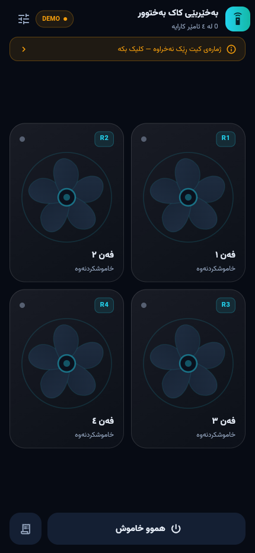
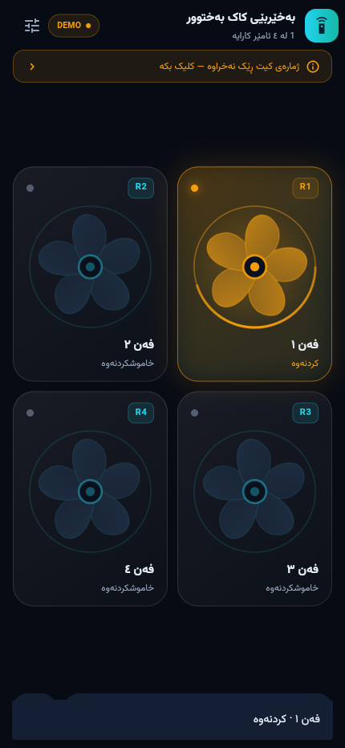

# SIM800 4-Channel SMS Relay — اپ + فریمور + مدار

پروژه کامل یک کیت کنترل ۴ وسیله برقی با پیامک، شامل مدار، فریمور AVR و اپلیکیشن موبایل.

| بخش | مسیر | وضعیت |
|---|---|---|
| اپ اندروید (Flutter) | `lib/` + `android/` | ✅ UI طبق Asset Kit + بیلد APK |
| سند طراحی/معماری برای AI | `docs/DESIGN_AND_ARCHITECTURE.md` | ✅ |
| اپ iOS | `ios/` | ✅ SMS با Messages (کاربر Send می‌زند)؛ بیلد روی مک/CI |
| فریمور ATmega32 | `firmware/atmega32/` | ✅ نوشته شد |
| طراحی مدار + BOM | `docs/circuit.md` | ✅ |
| دیاگرام سیم‌کشی | `docs/wiring.svg` | ✅ |
| پروتکل پیامکی | `docs/protocol.md` | ✅ |
| پرامپت طراحی UI (ChatGPT) | `docs/ui-prompt.md` | ✅ |

## پیش‌نمایش

| صفحه خانه | فن روشن (حالت DEMO) |
|---|---|
|  |  |

---

## اپ چطور کار می‌کند؟

کیت یک سیم‌کارت SIM800L دارد. اپ به آن **پیامک** می‌فرستد و کیت اجرا می‌کند:

| دکمه در اپ | پیامک ارسالی |
|---|---|
| فن ۱ روشن | `R1EN` + رمز |
| فن ۱ خاموش | `R1DS` + رمز |
| همه خاموش | چهار پیامک `R1DS…R4DS` |

پیامک از داخل خود اپ با `SmsManager` ارسال می‌شود؛ **هیچ‌وقت برنامه پیامک باز نمی‌شود** و متن فرمان روی صفحه دیده نمی‌شود. صفحه‌های اپ:

1. **اسپلش** — انیمیشن ورود با متن کردی سورانی «بەخێربێی کاک بەختوور»
2. **خانه** — چهار کارت فن؛ با لمس، فن می‌چرخد (روشن) یا می‌ایستد (خاموش)
3. **تۆمار (لاگ)** — تاریخچه فرمان‌های ارسالی
4. **ڕێکخستن** — شماره کیت، رمز ۴ رقمی، نام دستگاه‌ها، ارسال بی‌صدا

### درباره «مخفی بودن پیامک»

- ارسال با `SmsManager.sendTextMessage` → بدون UI، بدون باز شدن اپ پیامک ✅
- ولی روی بعضی گوشی‌ها ممکن است پیام در پوشه «ارسال‌شده» اپ پیامک ثبت شود.
  برای مخفی‌سازی کامل باید اپ **SMS پیش‌فرض** گوشی باشد (دسترسی سنگین) یا کنترل را
  از اینترنت (GPRS + سرور) انجام دهیم — که در نسخه بعدی قابل اضافه شدن است.
- مجوز `SEND_SMS` لازم است؛ در اولین اجرا درخواست می‌شود.

---

## بیلد اپ اندروید

پیش‌نیاز: Flutter 3.47+ ، JDK 17 ، Android SDK 35 (همه در `E:\dev` نصب شده‌اند)

```powershell
$env:JAVA_HOME="E:\dev\jdk"
$env:ANDROID_HOME="E:\dev\android-sdk"
$env:PATH="E:\dev\jdk\bin;E:\dev\flutter\bin;$env:PATH"
cd "E:\workups\app sim800"
flutter build apk --release
```

خروجی: `build\app\outputs\flutter-apk\app-release.apk`

فایل آماده نصب در `dist\SIM800-Control-v1.0.0.apk` کپی شده است
(حدود ۴۸ مگابایت، شامل arm64 + armeabi-v7a + x86_64).

> APK با کلید **debug** امضا شده؛ برای نصب دستی روی گوشی مشکلی ندارد،
> ولی برای انتشار در Google Play باید کلید release بسازی.

APK سبک‌تر (حدود ۱۷ مگابایت برای هر معماری):

```powershell
flutter build apk --release --split-per-abi
```

### اگر بیلد گیر کرد

- **دانلود بی‌مورد NDK**: این اپ کد نیتیو ندارد؛ خط `ndkVersion` از
  `android/app/build.gradle.kts` حذف شده تا ۱ گیگابایت NDK دانلود نشود.
- **خطای Kotlin incremental cache** وقتی pub cache روی درایو `C:` و پروژه روی
  درایو دیگری است: در `android/gradle.properties` مقدار `kotlin.incremental=false`
  تنظیم شده است.
- **دسترسی به pub.dev / storage.googleapis.com**: از میرورهای
  `PUB_HOSTED_URL=https://pub.flutter-io.cn` و
  `FLUTTER_STORAGE_BASE_URL=https://storage.flutter-io.cn` استفاده کن.

### اجرا روی گوشی

```powershell
flutter devices
flutter run -d <device-id>
```
یا APK را روی گوشی کپی و نصب کن (نصب از منابع ناشناس را فعال کن).

### دیدن اپ روی کامپیوتر (پیش‌نمایش وب)

بدون گوشی و بدون شبیه‌ساز هم می‌توانی UI را ببینی. یک‌بار نسخه وب را بساز:

```powershell
flutter build web --release --no-web-resources-cdn
```

بعد `preview.bat` را در ریشه پروژه دوبار کلیک کن — روی `http://localhost:8080`
سرو می‌شود و Chrome خودش باز می‌شود.

نکته‌ها:

- در مرورگر بدج «DEMO» نمایش داده می‌شود و لمس فن‌ها فقط انیمیشن را نشان می‌دهد؛
  پیامکی ارسال نمی‌شود (مرورگر دسترسی SMS ندارد).
- ارسال واقعی فقط با APK روی گوشی اندروید انجام می‌شود.
- اگر پورت ۸۰۸۰ اشغال بود، در `preview.bat` عدد پورت را عوض کن.

---

## iOS

ارسال پیامک با `MFMessageComposeViewController` پیاده شده: اپ شماره و متن فرمان را پر می‌کند،
صفحه **Messages** باز می‌شود و کاربر دکمه **Send** را می‌زند (متن دیده می‌شود — محدودیت اپل).

تفاوت با اندروید:

| | اندروید | iOS |
|---|---|---|
| ارسال | بی‌صدا با `SmsManager` | صفحه Messages + تأیید کاربر |
| همگام‌سازی خودکار STATUS | ✅ | ❌ (هر بار Messages باز می‌شد) |
| دریافت پاسخ کیت در اپ | ✅ با `RECEIVE_SMS` | ❌ |

بیلد (نیاز به **macOS** + Xcode یا CI ابری مثل Codemagic):

```bash
flutter build ios --release
# یا برای نصب روی دستگاه متصل:
flutter run -d <iphone-id>
```

خروجی `.ipa` برای توزیع خارج از App Store نیاز به Apple Developer حساب و امضای مناسب دارد.
روی سیمولاتور iOS معمولاً SMS کار نمی‌کند؛ تست واقعی با آیفون + سیم‌کارت.

---

## ساختار پروژه

```
android/           اپ اندروید (Flutter + کانال بومی SmsManager)
ios/               اپ iOS (اسکلت)
web/               فقط پیش‌نمایش مرورگری (حالت DEMO، بدون SMS)
dist/              APK آماده نصب
preview.bat        سرو کردن build\web روی http://localhost:8080
lib/
  main.dart        نقطه شروع
  theme.dart       رنگ‌ها و تایپوگرافی
  models.dart      مدل دستگاه و لاگ
  store.dart       ذخیره تنظیمات (shared_preferences)
  sms_service.dart کانال بومی ارسال پیامک
  screens/         splash, home, settings, log
  widgets/         fan_card + fan_painter (فن برداری و چرخان)
assets/fonts/      Vazirmatn (پشتیبانی کردی/فارسی — مجوز OFL)
firmware/atmega32/ فریمور AVR-GCC
docs/              مدار، پروتکل، پرامپت طراحی
```

---

## مرحله بعد

- [ ] دریافت طراحی از ChatGPT (پرامپت در `docs/ui-prompt.md`) و پیاده‌سازی دقیق
- [ ] تست روی گوشی واقعی با کیت
- [ ] پشتیبانی از پیامک چندبخشی و تشخیص تحویل (DeliveryReport)
- [ ] نسخه iOS
